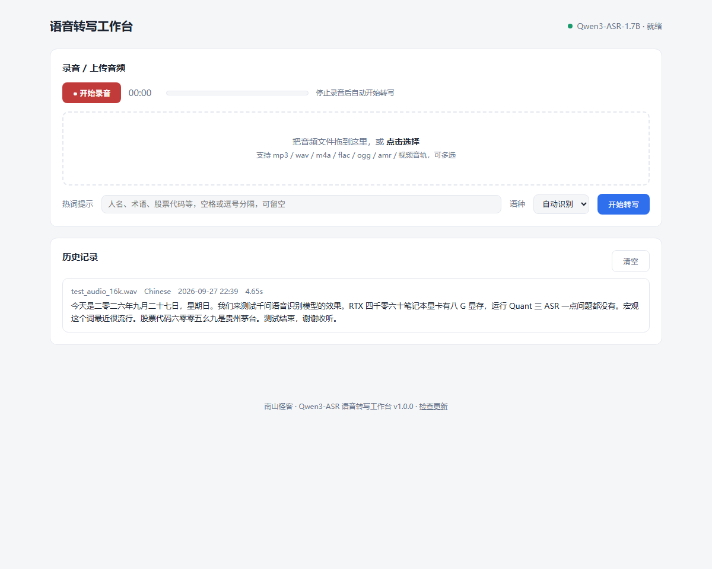

# Qwen3-ASR 语音转写工作台

本地运行的语音转写桌面工具：录音或上传音频，一键转成文字。基于阿里 [Qwen3-ASR-1.7B](https://github.com/QwenLM/Qwen3-ASR)（Apache 2.0），模型在你的电脑上推理，音频不上传任何服务器。

**作者：南山怪客**



## 功能

- **录音转写**：页面内直接录音，带计时和音量指示，停止后自动转写
- **文件转写**：拖拽上传 mp3 / wav / m4a / flac / ogg / amr / 视频音轨，可多选
- **热词提示**：填入人名、术语、代码等，专有名词准确率明显提升
- **语种选择**：自动识别，或锁定中 / 英 / 日 / 韩 / 粤语
- **52 种语言 + 22 种中文方言**，支持中英混说、歌词识别
- **结果管理**：复制全文、下载 .txt / .md、历史记录（本地保存最近 200 条）
- **检查更新**：页脚一键对比 GitHub 最新版本

## 系统要求

- Windows 10/11
- Python 3.10+（[python.org](https://www.python.org/downloads/)，安装时勾选 *Add python.exe to PATH*）
- 有 NVIDIA 显卡更快（4GB+ 显存即可），没有也能用 CPU 跑（速度约为实时的 0.5 倍）

## 安装

1. 到 [Releases](https://github.com/Jesse1024/qwen-asr-workbench/releases) 下载 `qwen-asr-workbench-v1.0.0.zip`，解压到任意目录
2. 双击 `install.bat`，等待完成（自动装依赖 + 下载 4.7GB 模型，走国内 ModelScope 直连）
3. 双击桌面的「语音转写工作台」图标开始使用

依赖装好后如需启用 NVIDIA 显卡加速（推荐），再运行一次 `download-model.bat`，它会自动把 PyTorch 升级为 CUDA 版。

## 更新

- 页面页脚点「检查更新」查看新版本
- 有新版时运行安装目录的 `update.bat`（自动下载新版页面和服务端，并检查显卡升级 PyTorch）

## 卸载

运行 `uninstall.bat`，会停掉服务、删除桌面快捷方式和整个安装目录（含模型）。

## 目录结构

```
server.py               后台服务（HTTP API + 模型推理）
app/index.html          可视化界面
app/工作台.bat           一键启动（自动拉起服务 + 打开窗口）
install.bat/ps1         安装
update.bat/ps1          更新 + GPU torch 升级
uninstall.bat/ps1       卸载
download-model.bat/ps1  模型下载 / 重新下载
```

## 技术细节

- 模型常驻显存（bf16 约 4GB），只加载一次，转写约 3 倍实时（RTX 4060 实测）
- 音频经 ffmpeg 统一转 16kHz 单声道（imageio-ffmpeg 自带，无需单独安装）
- 纯本地：HTTP 服务只绑 127.0.0.1，历史记录存本地 JSON
- License: MIT（界面与脚本部分）；模型权重遵循 Qwen3-ASR 的 Apache 2.0

## 更新日志

### v1.0.0 (2026-09-27)

- 首个公开版本：录音/上传转写、热词、语种锁定、历史记录、检查更新
